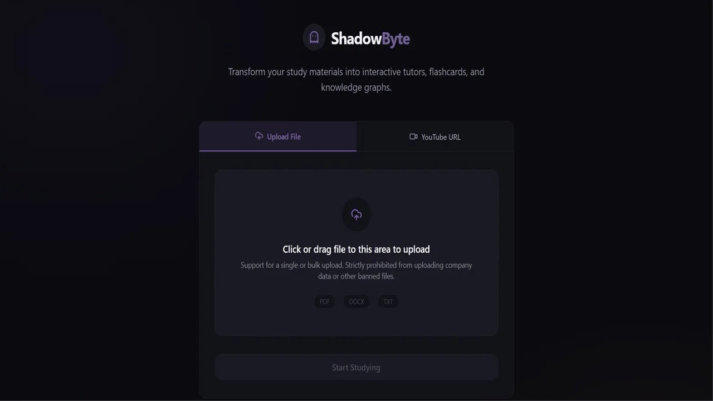
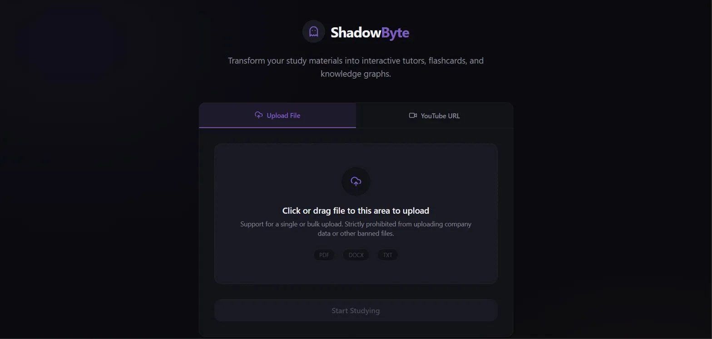
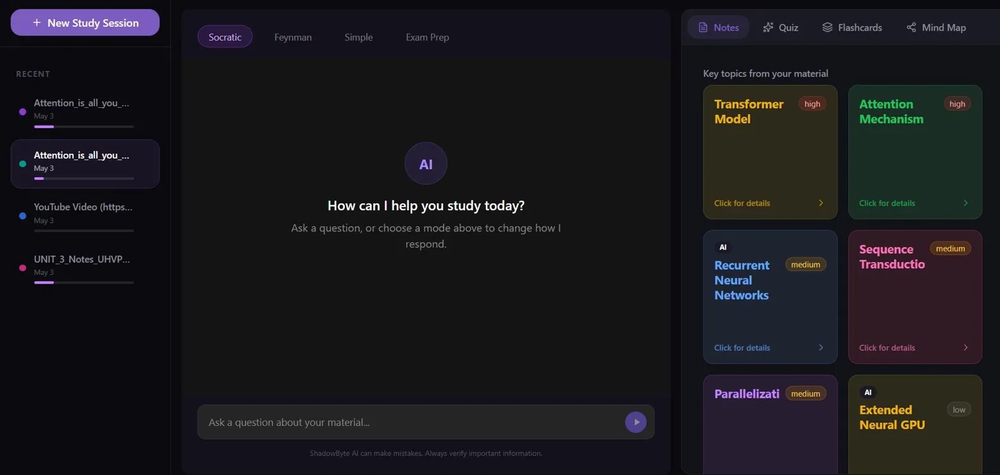
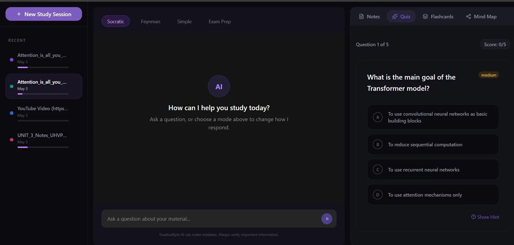
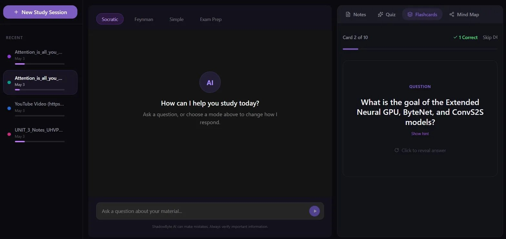
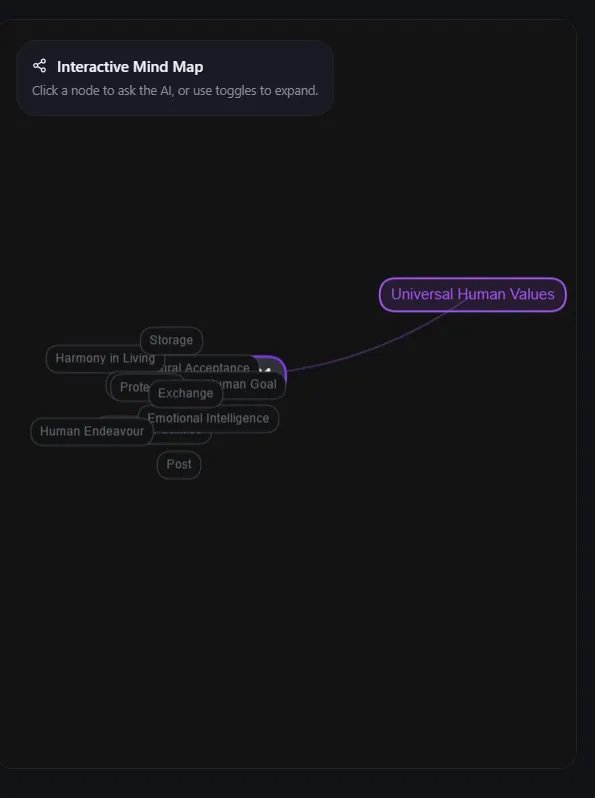

# Yukti — AI Teaching Assistant

<p align="center">
  
</p>

<p align="center">
  <strong>Learn smarter. Understand deeper. Progress at your own pace.</strong>
</p>

<p align="center">
  An AI-powered learning platform combining intelligent tutoring, personalized study resources, and adaptive learning to make studying more interactive and effective.
</p>

<p align="center">
  
  
  
  
  
</p>

---

## Overview

**Yukti** is an AI Teaching Assistant designed to help learners move beyond simply receiving answers and toward developing a deeper understanding of concepts.

It combines conversational AI and Retrieval-Augmented Generation (RAG) with personalized study tools and an adaptive learning layer. The system includes components for tracking learner mastery, identifying misconceptions, optimizing learning paths, and selecting appropriate learning activities based on available learner data.

Instead of treating every learner identically, Yukti aims to make learning more responsive to individual progress, confidence, and understanding.

## Key Features

### 1. AI-Powered Tutoring
- Ask questions and explore academic concepts through conversational AI.
- Use retrieved learning context to support relevant, grounded responses.
- Access different teaching modes, including Socratic questioning, simple explanations, Feynman-style learning, and exam preparation.

### 2. Document-Based Learning
- Upload supported learning materials.
- Extract and process document content.
- Split content into manageable chunks, generate embeddings, and retrieve relevant information for AI-assisted learning.
- Process supported YouTube learning content through the document-processing pipeline.

### 3. AI-Generated Study Resources
- **Quizzes:** Generate multiple-choice and short-answer questions.
- **Flashcards:** Review concepts through active recall and supported revision scheduling.
- **Smart Notes:** Generate structured study notes from learning content.
- **Mind Maps:** Explore connections between concepts through visual knowledge graphs.

### 4. Adaptive Learning Engine
Yukti includes a dedicated adaptive-learning layer designed to make learning decisions more context-aware.

- **Mastery Engine:** Updates learner mastery from assessment evidence.
- **Path Optimizer:** Recommends learning actions using mastery, confidence, prerequisites, and other available learner signals.
- **Misconception Detector:** Identifies potential misunderstandings from assessment responses.
- **Adaptive Question Engine:** Helps determine appropriate question difficulty and type.
- **Adaptive Orchestrator:** Coordinates learning-path recommendations and question planning.
- **Metacognitive Check-ins:** Records learner confidence and reflection signals.
- **Spaced Review:** Supports revision of concepts when review is due.
- **Learning Analytics:** Exposes learner and session-level progress information.

### 5. Authentication and Session Management
- User registration and login.
- Authenticated API access.
- Session-aware learning activities and history.
- Persistent storage for supported application data.

### 6. Background Processing
Celery and Redis support asynchronous processing for tasks such as document processing and study-resource generation, helping keep longer-running operations separate from normal API requests.

## Application Preview

The repository includes the following screenshots and demo assets.

| Interface | Preview |
|---|---|
| Dashboard |  |
| AI Chat |  |
| Quiz Interface |  |
| Flashcards |  |
| Mind Map |  |

## Technology Stack

| Layer | Technologies |
|---|---|
| Frontend | React, TypeScript, Vite |
| Backend | Python, Flask, REST APIs |
| AI orchestration | LangChain, LangGraph |
| Language models | Groq API, Google Gemini for quiz generation |
| Retrieval | Retrieval-Augmented Generation (RAG), FAISS |
| Embeddings | FastEmbed |
| Document processing | PyMuPDF, pypdf, python-docx, python-pptx and supporting loaders |
| Database and persistence | Supabase integration and application database utilities |
| Background tasks | Celery, Redis |
| Deployment | Docker, Gunicorn, Supervisor |

*The technologies listed reflect the repository's dependencies and implementation. The exact provider or service used for a particular operation depends on its configuration.*

## System Architecture

```text
                         LEARNER
                            |
                            v
                    React + TypeScript
                         Frontend
                            |
                            v
                      Flask REST API
                            |
             +--------------+--------------+
             |              |              |
             v              v              v
         AI Chat         Quiz Engine    Study Tools
             |              |         Notes / Cards
             |              |         Mind Maps
             v              v              |
       RAG Workflow    Assessment Logic    |
             |              |              |
             |              v              |
             |       Mastery Engine        |
             |              |              |
             |       Misconception         |
             |         Detection           |
             |              |              |
             |       Learner State         |
             |              |              |
             |       Path Optimizer        |
             |              |              |
             +------> Adaptive Orchestrator
                            |
                            v
                    Next Learning Action
                            |
                            v
                      Learner Feedback
                            |
                            +----> State Update

       Retrieval / AI Services       Background Jobs
          |             |               |
          v             v               v
        FAISS        Groq / Gemini   Celery + Redis
          |
          v
   Relevant Learning Context

          Persistence and Storage
                    |
                    v
              Database Layer
```

The adaptive-learning components are designed to support a feedback-driven learning cycle:

**Teach → Assess → Analyze → Update Learner State → Recommend → Teach Again**

The effectiveness of this cycle depends on the quality of assessment evidence, the learner-state updates, and the decisions made by the adaptive components.

## Project Structure

```text
Yukti/
├── agents/
│   ├── adaptive_orchestrator.py
│   ├── adaptive_question_engine.py
│   ├── concept_registry.py
│   ├── mastery_engine.py
│   ├── misconception_detector.py
│   ├── path_optimizer.py
│   ├── prompts.py
│   ├── rag_workflow.py
│   └── video_recommender.py
├── frontend/
│   ├── public/
│   └── src/
│       ├── components/
│       ├── hooks/
│       ├── lib/
│       └── pages/
├── llm/
│   ├── generator.py
│   └── gemini_generator.py
├── loaders/
├── processing/
├── retrieval/
├── routes/
├── services/
├── tests/
├── utils/
├── app.py
├── celery_app.py
├── db.py
├── tasks.py
├── requirements.txt
├── Dockerfile
├── CODE_OF_CONDUCT.md
├── CONTRIBUTING.md
└── README.md
```

## Getting Started

### Prerequisites

Install the following before running Yukti locally:

- Python 3.11
- Node.js and npm
- Git
- Redis, for background task processing
- API credentials for the AI providers and other services you intend to use

### 1. Clone the Repository

```bash
git clone https://github.com/atharvahule24/Yukti.git
cd Yukti
```

### 2. Configure Environment Variables

Create your local environment file from the supplied template.

**Windows PowerShell:**

```powershell
Copy-Item .env.sample .env
```

**macOS / Linux:**

```bash
cp .env.sample .env
```

Configure the required values in `.env`, using the variable names provided in `.env.sample`.

Depending on the features you enable, configuration may include:

- `GROQ_API_KEY` — Groq-powered AI functionality.
- `REDIS_URL` — Redis connection for Celery.
- `QUIZ_GEMINI_API_KEY` — Gemini-powered quiz generation.
- `LANGCHAIN_API_KEY` — LangSmith tracing, if enabled.
- `TWILIO_ACCOUNT_SID`, `TWILIO_AUTH_TOKEN`, and `TWILIO_VERIFY_SERVICE_SID` — Twilio Verify functionality, if enabled.
- `ALLOWED_ORIGINS` — permitted frontend origins for backend requests.

Do not commit your `.env` file or expose API keys in screenshots, logs, or public issues.

Configure the required persistence and storage services according to the application's database configuration before using features that depend on them.

### 3. Install Backend Dependencies

From the repository root:

```bash
python -m venv .venv
```

Activate the virtual environment.

**Windows PowerShell:**

```powershell
.\.venv\Scripts\Activate.ps1
```

**macOS / Linux:**

```bash
source .venv/bin/activate
```

Install the dependencies:

```bash
python -m pip install --upgrade pip
pip install -r requirements.txt
```

### 4. Install Frontend Dependencies

```bash
cd frontend
npm install
```

### 5. Configure and Start Redis

Ensure Redis is running and that `REDIS_URL` in your `.env` points to the correct instance.

### 6. Start the Backend

Open a terminal at the repository root, activate the Python virtual environment, and run:

```bash
python app.py
```

The application includes a health endpoint at:

```text
/api/health
```

When the backend is running locally with its default Flask configuration, the health endpoint is typically available at `http://127.0.0.1:5000/api/health`.

### 7. Start the Frontend

In a separate terminal:

```bash
cd frontend
npm run dev
```

If the frontend and backend run on different origins, configure the frontend API base URL using `VITE_API_BASE_URL` and allow the frontend origin through `ALLOWED_ORIGINS`.

### 8. Start the Background Worker

For asynchronous features, open another terminal at the repository root and run:

```bash
celery -A celery_app.celery worker --loglevel=info
```

On Windows, Celery may require the `solo` worker pool:

```bash
celery -A celery_app.celery worker --pool=solo --loglevel=info
```

Keep the backend, frontend, Redis service, and worker running as required by the features being tested.

## Development Commands

Run these commands from the `frontend/` directory.

**Start the development server:**

```bash
npm run dev
```

**Build the frontend:**

```bash
npm run build
```

**Run frontend lint checks:**

```bash
npm run lint
```

Run backend tests from the repository root:

```bash
python -m pytest
```

The repository contains a `tests/` directory with tests covering selected integration, resilience, assessment, and adaptive-learning behaviors.

## Adaptive Learning: How It Works

Yukti's adaptive-learning components are organized around the following workflow:

1. **Collect evidence:** Capture assessment results and supported learner signals.
2. **Estimate mastery:** Update the learner's concept-level state using assessment evidence.
3. **Identify misconceptions:** Analyze responses for potential misunderstandings.
4. **Check prerequisites:** Consider prerequisite concepts when deciding what should be reviewed.
5. **Optimize the path:** Recommend a learning action based on the available learner state.
6. **Plan the next question:** Select a suitable concept, question type, and difficulty.
7. **Repeat:** Use subsequent assessment evidence to inform future learning decisions.

For example, if a learner struggles with recursion because they misunderstand the base case, an adaptive learning path may recommend targeted review and easier practice before progressing to a more advanced topic.

This is the intended adaptive-learning approach; actual outcomes depend on the learner data available and the implementation of each decision rule.

## API Overview

The Flask application registers API route modules for the following areas:

| Area | Purpose |
|---|---|
| Authentication | Registration, login, and authentication-related operations |
| Uploads | Learning-material uploads and processing |
| Chat | AI tutoring conversations and chat history |
| Quizzes | Quiz generation, assessment, and adaptive question planning |
| Flashcards | Flashcard generation, progress, and revision scheduling |
| Notes | Study-note generation and retrieval |
| Knowledge Graph | Concept graph generation and retrieval |
| Sessions | Learning session management |
| Learner Analytics | Progress analytics and next-action recommendations |

The API is organized under the `/api` prefix. Refer to the route modules in `routes/` for endpoint definitions, request formats, and authentication requirements.

## Security and Privacy

- Keep API credentials and private configuration out of version control.
- Use authenticated endpoints and respect session ownership.
- Do not upload sensitive personal or academic information unless appropriate safeguards are in place.
- Review data retention, storage, and provider policies before using the application with real student data.
- Report suspected vulnerabilities privately to the project maintainer rather than publishing exploit details.

## Contributing

Contributions are welcome, including bug fixes, adaptive-learning improvements, documentation updates, and new study tools.

Please read [CONTRIBUTING.md](CONTRIBUTING.md) before opening a pull request and follow the project's [Code of Conduct](CODE_OF_CONDUCT.md).

## Roadmap

Potential areas for continued development include:

- Improving the reliability of learner mastery estimates.
- Evaluating misconception detection against real assessment examples.
- Refining prerequisite-aware learning-path recommendations.
- Improving adaptive question selection and revision scheduling.
- Expanding automated tests for end-to-end learning workflows.
- Improving accessibility and the usability of generated study resources.

These are development opportunities, not claims that every item is already implemented.

## Author

**Atharva Hule**

- GitHub: [@atharvahule24](https://github.com/atharvahule24)

## License

No license is specified in this README. Check the repository for an existing license before distributing or reusing the code. If you intend to publish Yukti as an open-source project, select and add an appropriate license.

---

If you find Yukti useful, consider starring the repository and sharing feedback or suggestions through GitHub Issues.
